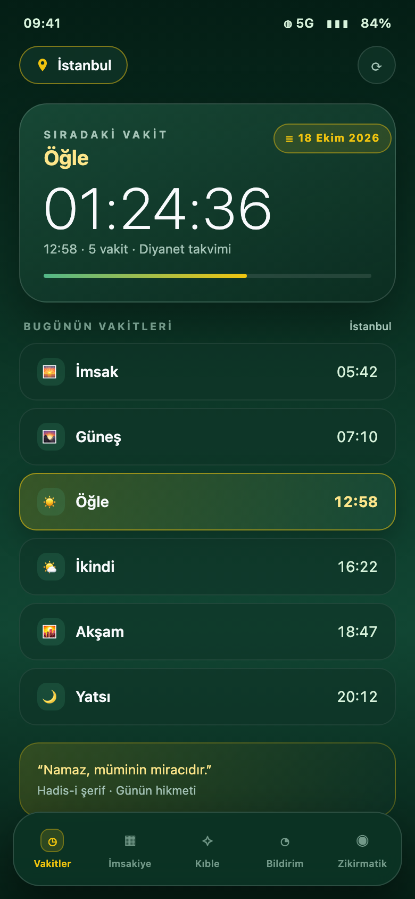

# 🕌 Namaz Vakti & İmsakiye

> A calm, ad-free Android prayer-times app with Diyanet data, a monthly imsakiye, qibla compass, tasbih counter and a home-screen widget.

[](https://developer.android.com/)
[](https://kotlinlang.org/)
[](https://developer.android.com/jetpack/compose)
[](LICENSE)

<p align="center">
  <a href="https://www.buymeacoffee.com/cmtrkr"></a>
</p>

Namaz Vakti is a minimalist Turkish prayer companion built with **Kotlin**, **Jetpack Compose (Material 3)**, **Room** and **Coroutines/Flow**. It fetches verified prayer times for all 81 provinces and districts from the **Diyanet** (Turkish Presidency of Religious Affairs) API, caches them offline, and presents them in a deep emerald-and-gold interface designed to stay readable day and night.

There are no ads, no accounts, no analytics and no paid tiers.

## 📸 Screenshot

<p align="center">
  
  <br>
  <sub>Representative preview built from the app's real Compose theme, screen structure and Turkish labels — not a device capture.</sub>
</p>

## ✨ Features

- 🕋 **Diyanet prayer times** — current and monthly times for all Turkish provinces and districts.
- 📍 **Location detection** — one-tap city detection with `FusedLocationProviderClient` and reverse geocoding.
- ⏳ **Next-prayer countdown** — live countdown card with progress and today's full schedule.
- 📱 **Home-screen widget** — current/next prayer, remaining time and a compact six-prayer strip.
- 🌊 **Liquid-glass navigation** — floating frosted bottom bar with emerald translucency and gold accents.
- 🧭 **Qibla compass** — calculates the Kaaba bearing from the user's coordinates using magnetometer and accelerometer data.
- 📅 **Monthly imsakiye** — 30-day Gregorian/Hijri-aligned table with today highlighted.
- 📿 **Tasbih counter** — haptic feedback, target counts (33, 99…), reset and preset dhikr phrases.
- 🔔 **Prayer notifications** — alerts at the prayer time or 15/30 minutes before, with adhan or notification tone.
- 📖 **Daily verse and hadith card** — a rotating spiritual quote.
- ⚡ **Offline-first** — Room caches the last fetched schedule; countdowns continue without internet.
- 🌗 **Light and dark palettes** — sage/mint light theme and deep emerald dark theme.

## 🛠️ Tech stack

| Layer | Choice |
| --- | --- |
| Language | Kotlin 2.0 |
| UI | Jetpack Compose, Material 3 |
| Architecture | MVVM + offline-first repository |
| Async | Coroutines, StateFlow |
| Local data | Room (SQLite), SharedPreferences |
| Network | Retrofit 2, Moshi, OkHttp |
| Location | Google Play Services Location |
| Sensors | Android `SensorManager` |
| Widget | `AppWidgetProvider`, `RemoteViews` |
| Tests | JUnit 4, Robolectric |

## 📁 Project structure

```text
app/src/main/
├── java/com/example/
│   ├── MainActivity.kt
│   ├── data/
│   │   ├── local/          # Room entities, DAO, database, city data
│   │   ├── model/          # DTO and domain models
│   │   ├── remote/         # Retrofit services and network client
│   │   └── repository/     # Offline-first prayer repository
│   ├── ui/
│   │   ├── components/     # Cards, liquid bar, schedule tables
│   │   ├── screens/        # Vakitler, İmsakiye, Kıble, Bildirim, Zikirmatik
│   │   ├── theme/          # Emerald gradient, colors, typography
│   │   └── viewmodel/
│   ├── util/               # Location, qibla, compass, notifications
│   └── widget/
└── res/
    ├── layout/widget_prayer_times.xml
    └── xml/prayer_widget_info.xml
```

## 🚀 Build and run

Requirements: Android Studio Ladybug or newer, JDK 17+, Android SDK 36.

```bash
git clone https://github.com/cmtrkr83/namaz-vakti.git
cd namaz-vakti
```

Open the project in Android Studio, let Gradle sync, then run on a device or emulator (minSdk 24).

Command line:

```bash
./gradlew assembleDebug        # debug APK
./gradlew testDebugUnitTest    # unit tests
```

Grant location and notification permissions on first launch. Without location permission you can still choose a city manually.

## 🔐 Permissions and privacy

| Permission | Why |
| --- | --- |
| `INTERNET`, `ACCESS_NETWORK_STATE` | Fetch Diyanet prayer times |
| `ACCESS_FINE_LOCATION`, `ACCESS_COARSE_LOCATION` | Detect the nearest city (optional) |
| `POST_NOTIFICATIONS` | Prayer reminders (optional) |
| `VIBRATE` | Tasbih haptics |

Location is used only to resolve the city; there is no account, analytics or advertising SDK, and no personal data is uploaded by the app.

## ⚠️ Notes

- The interface is in Turkish.
- Prayer times depend on Diyanet's published data; always confirm with your local mosque for critical timings.
- The app is not an official Diyanet application.

## ❤️ Support

If this app helps your daily routine, you can buy me a coffee:

<p align="center">
  <a href="https://www.buymeacoffee.com/cmtrkr"></a>
</p>

## 📄 License

[MIT](LICENSE) © 2026 Cem Türker.
